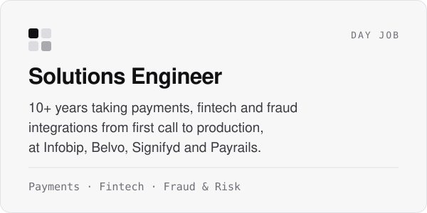
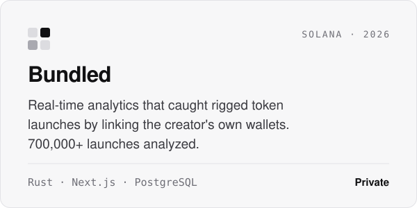
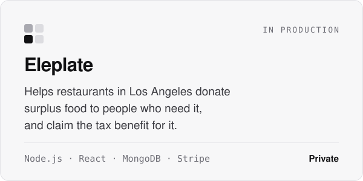
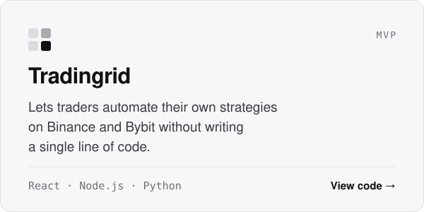

<picture>
  <source media="(prefers-color-scheme: dark)" srcset="assets/banner-dark.svg">
  
</picture>

 

I've spent the last 10 years on the technical side of payments, fintech and fraud, helping companies get from a whiteboard sketch to a live integration. Outside of work I build my own products, and lately I can't stop building with blockchain data. Everything on-chain is public, so you can make tools that read it all in real time and tell people what really happened.

### What I do

<picture><source media="(prefers-color-scheme: dark)" srcset="assets/now-dark.svg"></picture>
<picture><source media="(prefers-color-scheme: dark)" srcset="assets/bundled-dark.svg"></picture>
<picture><source media="(prefers-color-scheme: dark)" srcset="assets/eleplate-dark.svg"></picture>
<a href="https://github.com/luizdcastro/tradingrid_core_bot"><picture><source media="(prefers-color-scheme: dark)" srcset="assets/tradingrid-dark.svg"></picture></a>

### What I work with

<picture><source media="(prefers-color-scheme: dark)" srcset="assets/stack-dark.svg"></picture>

The older repos here are things I built while learning React, React Native and Node. I keep them up because they show where I started.
